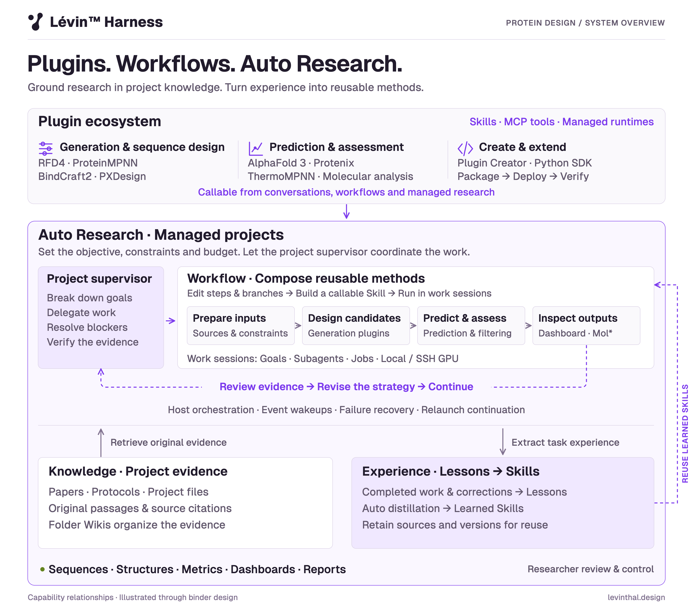
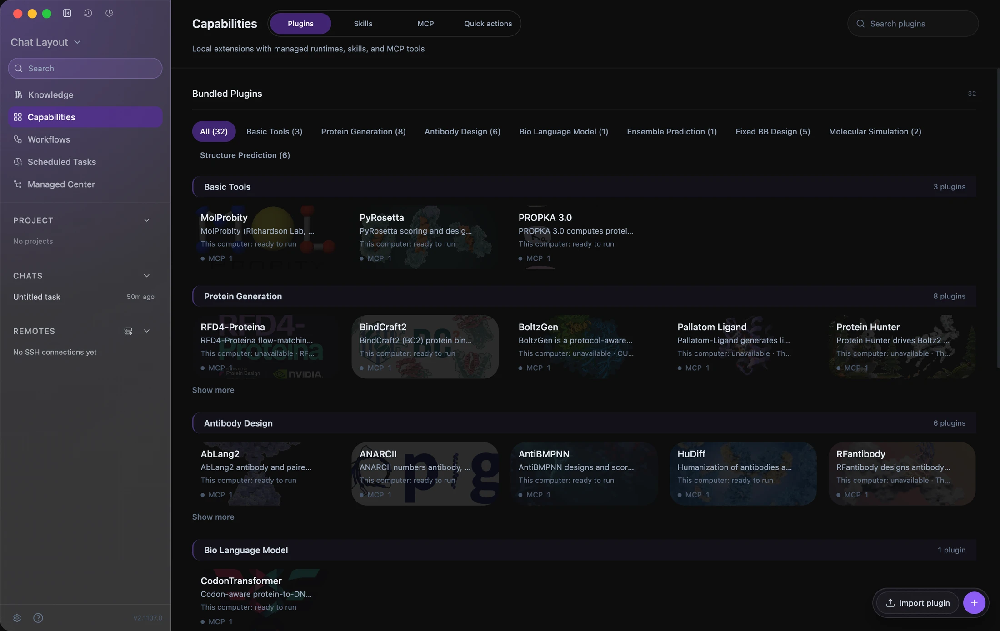
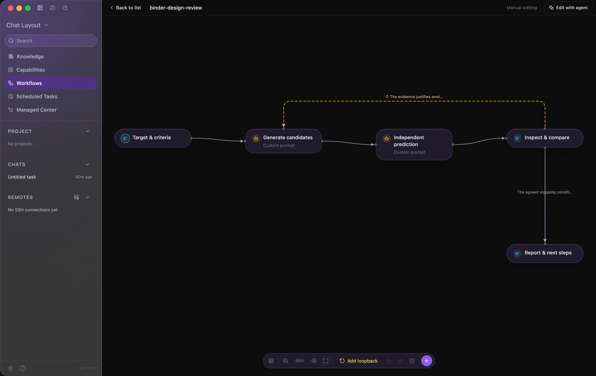
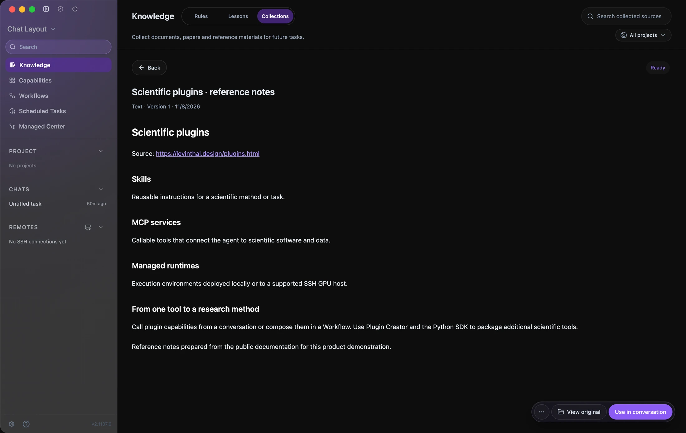
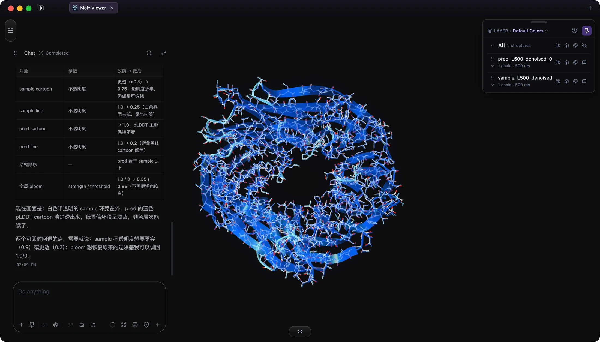

<h1 align="center">
  
  
</h1>

<strong>Make scientific discovery programmable.</strong>

  An agentic workbench for protein design and scientific research. 
  Connect plugins, Workflows, molecular context, project Knowledge and managed compute in one place.

<strong>English</strong> · <a href="README.zh-CN.md">简体中文</a>

  <strong><a href="https://github.com/levinthal/levin-harness/releases">Download for macOS &amp; Windows</a></strong> ·
  <a href="https://levinthal.design/docs.html">Documentation</a> ·
  <a href="https://levinthal.design/">Website</a> ·
  <a href="https://github.com/levinthal/levin-harness/issues/new/choose">Feedback</a>

## Plugins. Workflows. Auto Research.

Lévin™ Harness connects scientific tools into research that can keep moving: **extend capabilities with plugins, compose methods as Workflows, and delegate ongoing work to a project supervisor**. Project Knowledge grounds decisions in source material; the experience system turns useful Lessons into Skills for future tasks.

<picture>
  <source media="(prefers-color-scheme: dark)" srcset="assets/system-overview-dark.png" />
  <source media="(prefers-color-scheme: light)" srcset="assets/system-overview-light.png" />
  
</picture>

## One workspace for scientific work

### Extend your methods with scientific plugins

Use generation, prediction, sequence-design, validation and simulation tools from the same workspace. Plugins bundle **Skills, MCP tools and managed runtimes**. Deploy supported runtimes locally or to your own Linux GPU host over SSH, then call them from conversations, Workflows or managed research.

| Role | Examples in the plugin catalog |
| --- | --- |
| Generation and binder design | RFD4-Proteina, BindCraft2, BoltzGen, PXDesign |
| Sequence design | ProteinMPNN, FAMPNN, LigandMPNN |
| Structure prediction | AlphaFold 3, Protenix |
| Assessment and simulation | ThermoMPNN, MolProbity, PyRosetta, OpenMM |

Need another tool? **Plugin Creator and the Python SDK** help turn a scientific repository into a packaged capability: inspect its interfaces, build the adapter, deploy the runtime and verify a real run. Each tool retains its own license, weights and hardware requirements; the catalog shows availability for the selected device.

[Explore plugins and Plugin Creator](https://levinthal.design/plugins.html)

### Turn a method into a reusable Workflow

Describe the procedure, then refine the steps and branches with the agent on the same canvas. Combine MCP tools, Skills, subagents, manual review, other Workflows and dashboards. **Build turns the graph into a callable Skill** that the agent follows with new inputs.

*A real editor capture of an example protocol prepared for this page. The template has not been executed or scientifically validated.*

For a binder-design task, the method could connect:

1. **Target and criteria:** collect the target structure, source literature, interface constraints and compute budget.
2. **Generate:** use the selected design plugin and retain candidate sequences, structures and settings.
3. **Predict independently:** assess candidates with a separately chosen predictor and retain the actual outputs.
4. **Review:** compare metrics and structures, inspect interfaces in Mol*, and decide whether another round is justified.
5. **Report:** deliver files, evidence, limitations and the next decision.

The [example protocol source](examples/binder-design-review.workflow.json) contains the method and review gates. Configure and test it with your installed tools before use. Workflows guide agent execution; scientific outcomes depend on the chosen methods, inputs and assessment criteria.

[Explore Workflows](https://levinthal.design/workflows.html)

### Auto Research: let the project supervisor carry the work forward

Set an objective, constraints, completion evidence and a budget, then explicitly enroll the project in managed research. The **project supervisor** breaks down the work, delegates to goal-driven sessions, resolves blockers within the configured authority and checks delivery evidence.

Work sessions choose technical steps and use plugins, Workflows, subagents and **background Jobs**. Host orchestration tracks events and persistent state, handles recovery, and resumes eligible managed work after the app relaunches. You can inspect progress, change direction or pause the project in **Managed Center**.

For protein design, this connects a design round to the next decision: wait for real compute outputs, inspect what passed or failed, revise the strategy and continue within the configured budget. Jobs preserve status, logs and artifacts; supported remote outputs return to the project for review.

[Goals and work sessions](https://levinthal.design/goals.html) · [Background Jobs](https://levinthal.design/jobs.html) · [Remote GPU](https://levinthal.design/remote-gpu.html)

### Ground decisions in Knowledge

Collect papers, protocols, links, folders and project files. Retrieve **original passages with source citations** and use folder Wikis to navigate the material. The researcher and agent can return to the source behind a constraint, method or decision.

*Actual Knowledge capture using reference notes prepared from the public Lévin plugin documentation.*

### Turn research experience into reusable Skills

With learning enabled, completed conversations and corrections supply experience for **Lessons**. Suitable active Lessons can be consolidated and automatically distilled into **learned Skills** with prerequisites, procedures, pitfalls and verification steps. Sources and versions retain the basis of the procedure as it is updated and reused.

This closes the loop shown in the overview: **work → Lessons → learned Skills → subsequent work**. Knowledge supplies original evidence; experience preserves useful ways of working. The agent checks whether prior experience applies to the current task.

### Inspect molecular details in context

Bring structures, exact chain or residue selections and measurements into the agent conversation as structured references. Use Mol* to inspect interfaces, compare structures, adjust representations and review the files returned by scientific tools.

*An existing molecular visualization session showing a structure comparison and representation adjustments.*

[Explore the molecular workspace](https://levinthal.design/molecular-workspace.html)

## Download and get started

| Platform | Installer | Download |
| --- | --- | --- |
| macOS, Apple silicon | `.dmg` | [Releases](https://github.com/levinthal/levin-harness/releases) |
| Windows, x64 | `.exe` | [Releases](https://github.com/levinthal/levin-harness/releases) |

Select a release, read its notes and download the installer from **Assets**. This link stays the same as versions change. Linux GPU machines can serve as remote compute hosts; current releases do not include a Linux desktop installer.

1. **Install** the application for your platform.
2. **Connect a model** using a supported provider or compatible endpoint, including private or self-hosted services.
3. **Open a project**, review its permissions and configure the plugins and compute needed for the task.
4. **Start with a concrete objective.** Work in a conversation, refine a Workflow, or enroll the project in managed research.

[Installation guide](https://levinthal.design/install.html) · [Full documentation](https://levinthal.design/docs.html)

This repository hosts official releases, product information and user feedback. **The application source code is not public.** GitHub’s **Code > Download ZIP** and generated **Source code** archives contain repository documentation, images and examples, not the application.

## FAQ

### Is Lévin™ Harness free?

The preview is currently free for non-commercial use under the [Terms of Service](TERMS.md). Model providers, scientific tools and compute hosts may have separate costs or license requirements.

### Where does my data go?

Projects, conversations, settings and API keys are stored locally by default. Task content is sent to the model provider you configure; remote jobs may transfer required inputs to your selected compute host. See the [Privacy Policy](PRIVACY.md) and your provider’s settings.

### Does a successful computational screen establish binding?

Predictions and screening metrics are computational evidence. Experimental binding and biological function require appropriate experimental validation. The binder protocol above is an illustration of how the product’s capabilities connect, not a reported Lévin binder-design result.

## License and legal documents

The application is proprietary software. Non-commercial use is permitted under the Terms; modification, redistribution and commercial use require separate written permission. Integrated tools retain their own terms.

**Before installing or using the app, read these documents:**

| Document | English | 简体中文 |
| --- | --- | --- |
| License notice | [License](LICENSE.md#english) | [许可说明](LICENSE.md#中文) |
| Terms of Service | [Full text](TERMS.md) | [用户服务协议全文](TERMS.zh-CN.md) |
| Privacy Policy | [Full text](PRIVACY.md) | [隐私政策全文](PRIVACY.zh-CN.md) |

The Terms and Privacy Policy are reproduced from the website, version **V1.0**, effective **September 10, 2026**. The Chinese text prevails where the language versions differ, as specified in each document.

## Feedback and community

- [Report a bug or request a feature](https://github.com/levinthal/levin-harness/issues/new/choose). English and Chinese are welcome.
- Join [Discord](https://discord.gg/yENT5KyBT) or the [Feishu community](https://applink.feishu.cn/client/chat/chatter/add_by_link?link_token=93blb389-88ea-4c04-a071-fbff366977ae&qr_code=true) for usage and research workflow discussions.
- Read [Support](SUPPORT.md) for what to include in a useful report.

[Website](https://levinthal.design/) · [Documentation](https://levinthal.design/docs.html) · [License](LICENSE.md) · [Terms of Service](TERMS.md) · [Privacy Policy](PRIVACY.md)
