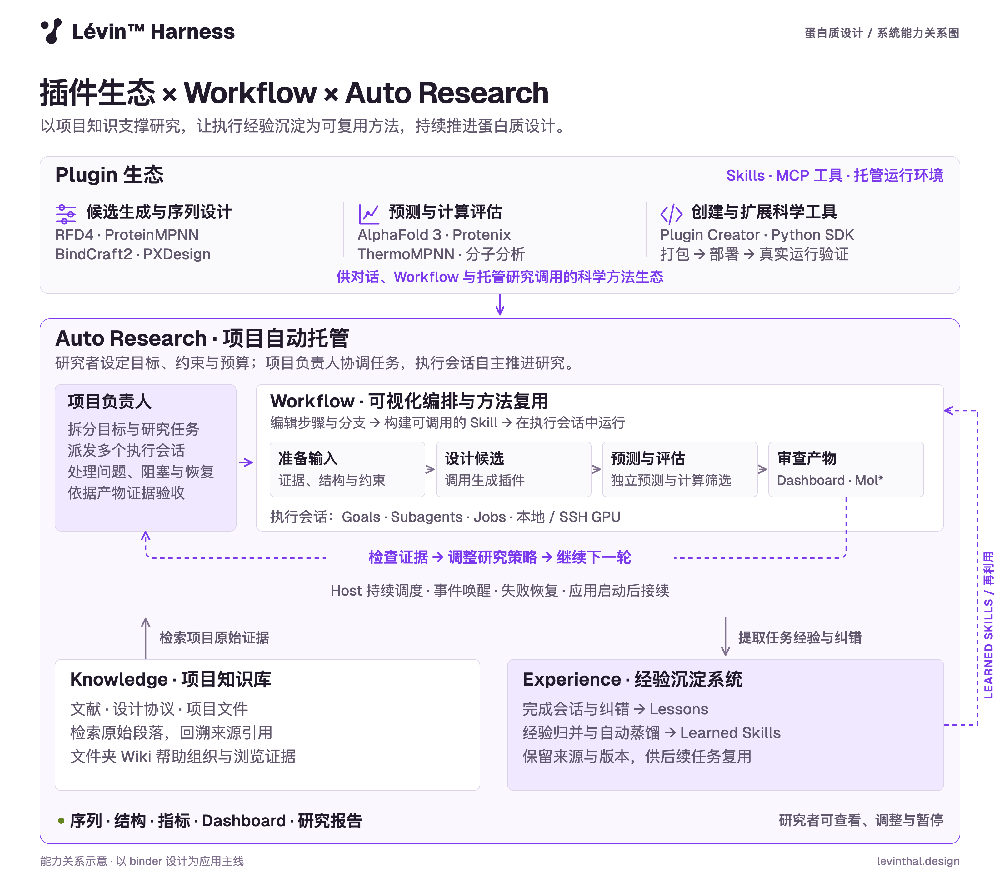
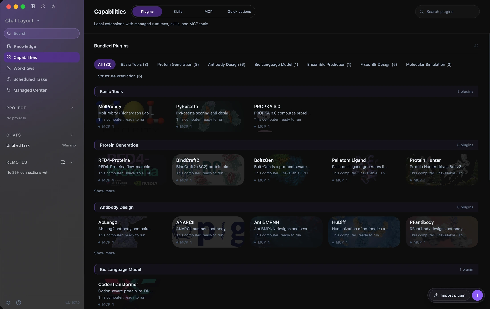
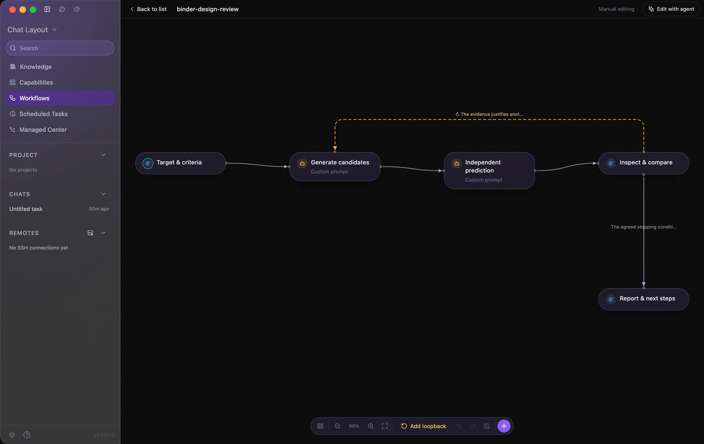
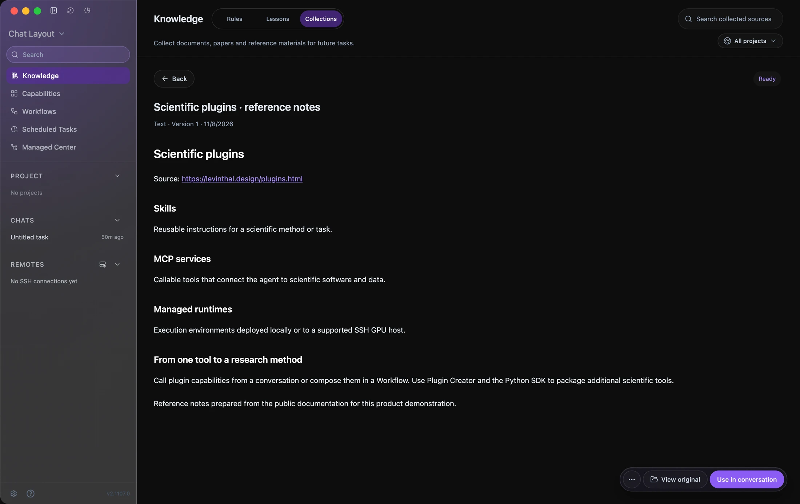
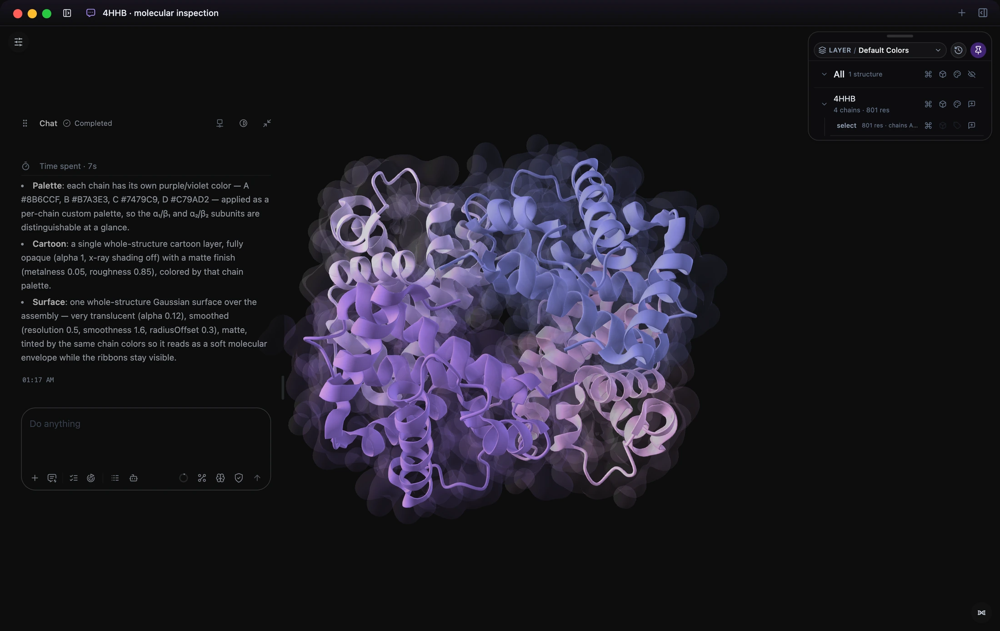

<h1 align="center">
  
  
</h1>

<strong>让科学发现可编程。</strong>

  面向蛋白质设计与科学研究的智能体工作台。 
  将插件、Workflow、分子上下文、项目知识与托管计算连接到同一个工作区。

<a href="README.md">English</a> · <strong>简体中文</strong>

  <strong><a href="https://github.com/levinthal/levin-harness/releases">下载 macOS 与 Windows 版</a></strong> ·
  <a href="https://levinthal.design/docs.html">使用文档</a> ·
  <a href="https://levinthal.design/">官网</a> ·
  <a href="https://github.com/levinthal/levin-harness/issues/new/choose">问题反馈</a>

## Plugins · Workflows · Auto Research

Lévin™ Harness 把科学工具连接成能够持续推进的研究过程：**用插件扩展能力，用 Workflow 沉淀方法，把持续工作交给项目主管协调**。知识库提供原始依据，经验系统将有用的 Lessons 提炼为后续任务可复用的 Skills。

<picture>
  <source media="(prefers-color-scheme: dark)" srcset="assets/system-overview-zh-dark.png" />
  <source media="(prefers-color-scheme: light)" srcset="assets/system-overview-zh-light.png" />
  
</picture>

## 在同一个工作区完成科研任务

### 用科学插件扩展研究方法

在同一个工作区调用生成、预测、序列设计、结构验证与模拟工具。插件将 **Skills、MCP 工具和托管运行环境**打包在一起。按支持情况部署到本机或自己的 Linux SSH GPU 服务器，再从对话、Workflow 或托管研究中调用。

| 研究环节 | 插件目录中的示例 |
| --- | --- |
| 生成与 Binder 设计 | RFD4-Proteina、BindCraft2、BoltzGen、PXDesign |
| 序列设计 | ProteinMPNN、FAMPNN、LigandMPNN |
| 结构预测 | AlphaFold 3、Protenix |
| 评估与模拟 | ThermoMPNN、MolProbity、PyRosetta、OpenMM |

需要其他工具时，可用 **Plugin Creator 和 Python SDK**，将科学工具仓库封装为可安装能力：分析接口、构建适配器、部署运行环境并验证真实调用。各工具适用各自的许可证、权重与硬件要求；目录会显示所选设备的可用情况。

[了解插件生态与 Plugin Creator](https://levinthal.design/plugins.html)

### 把研究方法变成可复用的 Workflow

描述方法，再与智能体在同一张画布上细化步骤与分支。组合 MCP 工具、Skills、子智能体、人工复核、其他 Workflow 与看板。**构建后，流程会成为可调用的 Skill**，供智能体在新输入上执行。

*为本页配置的示例协议在真实编辑器中的截图。模板尚未执行，也未经过科学验证。*

以 Binder 设计为例，可以把方法组织为：

1. **靶标与判据：** 收集靶标结构、文献依据、界面约束与计算预算。
2. **生成：** 调用选定的设计插件，保留候选序列、结构和设置。
3. **独立预测：** 用另行选择的预测方法评估候选，并保留实际输出。
4. **复核：** 比较指标与结构，在 Mol* 中检查界面，判断是否有依据进入下一轮。
5. **交付：** 整理文件、证据、局限与后续决策。

[示例协议源文件](examples/binder-design-review.workflow.json)包含方法说明和复核条件。使用前请根据已安装工具完成配置与测试。Workflow 为智能体提供执行方法，科研结果取决于选用的方法、输入与评估判据。

[了解 Workflows](https://levinthal.design/workflows.html)

### Auto Research：由项目主管持续协调研究

设定目标、约束、完成证据与预算，再明确开启项目托管。**项目主管**负责拆分工作、委派给带有持续目标的工作会话，在配置的权限内处理阻塞，并检查交付证据。

工作会话负责选择技术步骤，调用插件、Workflow、子智能体与**后台 Jobs**。Host 根据事件唤醒工作，持久化状态、处理恢复，并在应用重新启动后继续符合条件的托管任务。你可以在**托管中心**查看进展、调整方向或暂停项目。

在蛋白质设计中，这将一轮计算连接到下一次决策：等待真实计算产物，检查通过与失败的依据，调整策略，并在预算内继续。Jobs 保留状态、日志与文件；受支持的远程产物回到项目中供复核。

[持续目标与工作会话](https://levinthal.design/goals.html) · [后台 Jobs](https://levinthal.design/jobs.html) · [远程 GPU](https://levinthal.design/remote-gpu.html)

### 用知识库支撑研究判断

收集论文、协议、链接、文件夹和项目文件。检索**带有来源引用的原始段落**，通过文件夹 Wiki 理解材料。研究者与智能体都能回到某项约束、方法或决策背后的原始依据。

*实际知识库截图，收录内容为根据 Lévin 官网公开插件文档整理的参考笔记。*

### 将研究经验沉淀为可复用 Skills

开启学习后，已完成的对话与纠正可为 **Lessons** 提供经验。符合条件的活跃 Lessons 会被归纳并自动提炼为 **learned Skills**，包含适用前提、步骤、常见问题与验证方法。来源和版本保留方法依据，支持后续更新与复用。

这形成总览图中的反馈关系：**工作 → Lessons → learned Skills → 后续工作**。知识库保存原始证据，经验系统保存有用的工作方法；智能体会判断既有经验是否适用于当前任务。

### 在分子上下文中检查细节

将结构、精确的链或残基选择以及测量结果，作为结构化引用带入智能体对话。在 Mol* 中检查界面、比较结构、调整表示，并复核科学工具返回的项目文件。

*真实英文会话：为公开结构 4HHB 配置紫色链配色与半透明 Gaussian surface。*

[了解分子工作区](https://levinthal.design/molecular-workspace.html)

## 下载与开始使用

| 平台 | 安装包 | 下载 |
| --- | --- | --- |
| macOS，Apple silicon | `.dmg` | [Releases](https://github.com/levinthal/levin-harness/releases) |
| Windows，x64 | `.exe` | [Releases](https://github.com/levinthal/levin-harness/releases) |

选择版本、阅读说明，从 **Assets** 下载安装包。该下载入口无需随版本更新。Linux GPU 服务器可作为远程计算设备；当前 Releases 尚未提供 Linux 桌面安装包。

1. **安装应用。** 下载适合当前平台的安装包。
2. **连接模型。** 配置受支持的供应商或兼容接口，也可使用私有或自托管服务。
3. **打开项目。** 检查权限，配置研究方法需要的插件与计算设备。
4. **给出具体目标。** 在对话中开始工作，细化 Workflow，或开启项目托管。

[安装指南](https://levinthal.design/install.html) · [完整使用文档](https://levinthal.design/docs.html)

这是官方版本发布、产品说明与反馈仓库，**应用源码暂不公开**。GitHub 的 **Code > Download ZIP** 和自动生成的 **Source code** 压缩包只包含仓库中的文档、图片与示例，不包含应用程序。

## 常见问题

### 是否免费？

预览阶段目前对非商业用途免费，具体以[用户服务协议](TERMS.zh-CN.md)为准。模型供应商、科学工具与计算设备可能有单独的费用或许可要求。

### 数据存储在哪里？

项目、对话、设置与 API Key 默认保存在本机。任务内容会发送给你配置的模型服务商；远程任务可能向所选计算设备传输必要输入。详情见[隐私政策](PRIVACY.zh-CN.md)与模型服务商的相关设置。

### 计算筛选通过是否就代表能结合？

预测与筛选指标属于计算证据，实验结合与生物学功能需要适当的实验验证。上面的 Binder 协议用于说明产品能力如何连接，不是 Lévin 已完成的 Binder 设计成果报告。

## 许可与法律文件

本应用为专有软件。非商业用途可按协议使用；修改、再分发与商业使用需另行取得书面许可。集成工具适用各自条款。

**安装或使用应用前，请阅读以下文件：**

| 文件 | 简体中文 | English |
| --- | --- | --- |
| 许可说明 | [许可说明](LICENSE.md#中文) | [License](LICENSE.md#english) |
| 用户服务协议 | [协议全文](TERMS.zh-CN.md) | [Terms of Service](TERMS.md) |
| 隐私政策 | [政策全文](PRIVACY.zh-CN.md) | [Privacy Policy](PRIVACY.md) |

协议与隐私政策全文同步自官网，版本为 **V1.0**，生效日期为 **2026 年 9 月 10 日**。按各文件约定，中英文存在不一致、歧义或冲突时，以中文文本为准。

## 反馈与社区

- [报告问题或提出功能建议](https://github.com/levinthal/levin-harness/issues/new/choose)，支持中文和英文。
- 使用交流与科研工作流讨论可加入 [Discord](https://discord.gg/yENT5KyBT) 或[飞书社区](https://applink.feishu.cn/client/chat/chatter/add_by_link?link_token=93blb389-88ea-4c04-a071-fbff366977ae&qr_code=true)。
- 反馈所需信息见[支持说明](SUPPORT.md#中文)。

[官网](https://levinthal.design/) · [使用文档](https://levinthal.design/docs.html) · [许可说明](LICENSE.md#中文) · [用户服务协议](TERMS.zh-CN.md) · [隐私政策](PRIVACY.zh-CN.md)
